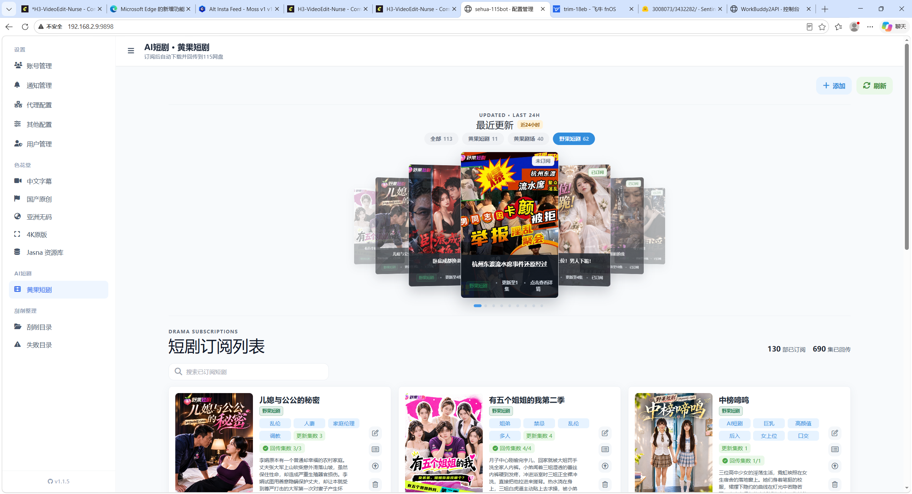
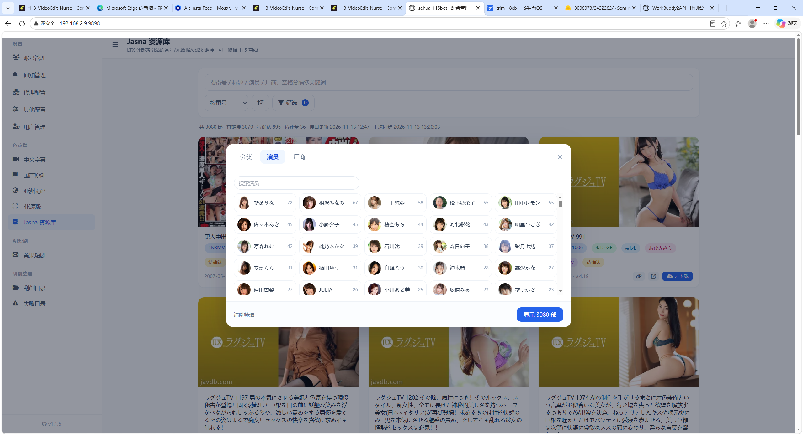
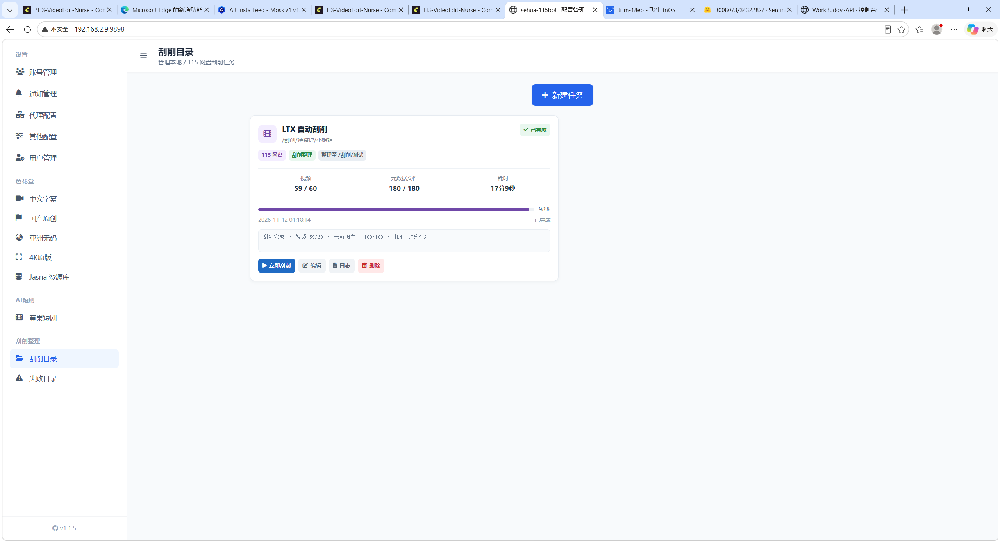

<h1 align="center">sehua-115bot</h1>

<p align="center">
  <b>色花磁力自动采集 · 黄果短剧自动追更 · 115 离线归档</b><br>
  <sub>按板块自动采集、按订阅自动追更、自动刮削元数据并回传 115 网盘 —— 全程可 Telegram 远程操作</sub>
  <p align="center"><sub>如果这个项目帮你省下了整理资源的时间，动动小手点一个 ⭐ Star</sub></p>
</p>

<p align="center">
  <a href="https://hub.docker.com/r/cayalume/sehua-115bot"></a>
  <a href="https://hub.docker.com/r/cayalume/sehua-115bot/tags"></a>
  
  
  
  <a href="https://t.me/sehua_115bot"></a>
</p>

<p align="center">
  <a href="#-快速开始">快速开始</a> ·
  <a href="#-功能">功能</a> ·
  <a href="#-命令手册">命令手册</a> ·
  <a href="#-界面预览">界面</a> ·
  <a href="#-常见问题">常见问题</a> ·
  <a href="#-更新日志">更新日志</a>
</p>

## 📌 这是什么

一个跑在自己服务器上的**资源自动化工具**。

你只需要配好一次：指定板块、订阅想看的短剧；之后的新内容由它自己发现、下载、刮削、推进 115，Emby / Jellyfin 里直接就能看。

适合已经用 115 + Emby 的人，想把「找资源 → 下载 → 整理 → 入库」这条链路彻底自动化，而不是每天手动贴磁力。

## 💬 交流与反馈

  - <a href="https://t.me/sehua_115bot"><b>Telegram 交流群</b></a>
  - <a href="https://github.com/cayalume/strm-CayFlow">CayFlow(strm工具)</a>
  - 提问题时建议附上：
```bash
docker logs --tail 100 sehua-115bot
```

以及 `/app/data/scrape_tasks/` 下对应任务的日志。
## ✨ 功能

| 模块 | 能力 |
| :--- | :--- |
| 🧲 **板块采集** | 按日期或页码范围采集指定板块，支持 `x-y` 区间一次跑完；中断或重复发指令都不会重复采集，自动跳过已完成页码 |
| 🍋 **短剧追更** | 订阅后自动发现新集，下载 → 刮削 → 回传，按 `Season 01/S01E01` 命名，Emby 直接识别 |
| 🗂 **LTX 资源库** | 索引型库，只存番号与链接不占空间；支持番号 / 标题 / 演员 / 厂商搜索，一键云下载到 115 |
| 🎬 **自动刮削** | 产出标准结构：`nfo` + `poster` + `fanart` + 分季目录；标题与简介会做择优与清洗，支持字幕刮削 |
| 🤖 **Telegram** | 采集、查询队列、中止任务、改保存路径都能在手机上完成，附件式推送海报卡片 |

**几个细节**

- 采集完成后按板块自动在 115 建同名目录，磁力分类落盘，不用手工整理
- 三个短剧源在页面里用颜色区分（🔵 黄果短剧 / 🟠 黄果剧场 / 🟢 野果短剧），可单源筛选
- 短剧支持「只下载不回传」，用于使用cd2用户直接存入其他网盘内

## 📷 界面预览

<p align="center">
  
  
  
  <br>
  <sub>面板首页：采集、短剧、LTX、刮削集中在左侧导航</sub>
</p>

## 🚀 快速开始

三步跑起来。镜像 `amd64` / `arm64` 双架构，地址见 [Docker Hub](https://hub.docker.com/r/cayalume/sehua-115bot)。

### 1. 建目录

```bash
mkdir -p /opt/sehua/data
touch /opt/sehua/config.yaml     # 必须先存在（可为空文件），否则容器启动即退出
```

### 2. 起容器  
docker run

```bash
docker run -d \
  --name sehua-115bot \
  --restart=always \
  --user root \
  --network host \
  -v /opt/sehua/data:/app/data \
  -v /opt/sehua/config.yaml:/app/config.yaml \
  -e TZ=Asia/Shanghai \
  -e HTTP_PROXY=http://127.0.0.1:7890 \
  -e HTTPS_PROXY=http://127.0.0.1:7890 \
  cayalume/sehua-115bot:latest
```

Docker Compose

```yaml
services:
  sehua-115bot:
    image: cayalume/sehua-115bot:latest
    container_name: sehua-115bot
    restart: always
    user: root
    network_mode: host
    volumes:
      - /opt/sehua/data:/app/data
      - /opt/sehua/config.yaml:/app/config.yaml
    environment:
      - TZ=Asia/Shanghai
      - HTTP_PROXY=http://127.0.0.1:7890      # 换成你自己的代理
      - HTTPS_PROXY=http://127.0.0.1:7890
```

> `network_mode: host` 下端口直接共享宿主机，不需要再写 `ports`。

</details>

### 3. 打开面板

浏览器访问 `http://你的IP:9898`，默认账号 `admin` / 密码 `admin`，**登录后立刻改密码**。

### 参数说明

| 参数 | 说明 |
| :--- | :--- |
| `--network host` | host 网络；此模式下 `-p` 参数无效 |
| `-v /opt/sehua/data:/app/data` | 数据库、日志、封面缓存、刮削产物、任务记录 |
| `-v /opt/sehua/config.yaml:/app/config.yaml` | 全部配置项，需提前创建空文件 |
| `-e HTTP_PROXY` / `HTTPS_PROXY` | 外网出口，采集与刮削都依赖它 |
| `-e TZ` | 时区，影响定时任务触发时间 |

### 系统要求

| 项 | 要求 |
| :--- | :--- |
| 内存 | **≥ 2GB**（采集峰值较高，否则可能被 OOM 杀掉） |
| 网络 | 稳定的外网代理出口，**代理不通则一切任务失败** |
| 磁盘 | ≥ 10GB（封面缓存 + 元数据） |
| 115 账号 | 可正常登录，未被登录保护拦截 |

## ⚙️ 首次配置

1. **改密码**：登录面板后在「设置」里改掉默认账号密码。
2. **绑定 115**：进入「设置 → 115 账号」，按提示扫码，成功后显示昵称与容量。
3. **配 Telegram**：找 `@BotFather` 发 `/newbot` 拿 Token，填进「设置 → Telegram」，Chat ID 可用 `@userinfobot` 获取。保存后机器人会主动推一条上线消息，收到即表示配置成功。
4. **设默认路径**：在 Telegram 发 `/setting`，选择 115 上的目标目录，之后所有任务默认落到这里。

## 🤖 命令手册

### 采集

| 命令 | 说明 | 示例 |
| :--- | :--- | :--- |
| `/sht 板块 日期 年-月-日` | 按日期爬取 | `/sht 103 日期 2026-06-22` |
| `/sht 板块 页数 x` | 爬取单页 | `/sht 36 页数 3` |
| `/sht 板块 页数 x-y` | 爬取页码范围 | `/sht 36 页数 1-5` |
| `/sht ltx 日期 年-月-日` | LTX 按收录日推 115 | `/sht ltx 日期 2026-11-01` |
| `/sht ltx 页数 x / x-y` | LTX 按页推 115 | `/sht ltx 页数 2-6` |

### 任务与设置

| 命令 | 说明 |
| :--- | :--- |
| `/tasks` | 查看任务队列与进度 |
| `/tz` | 停止当前任务 |
| `/115` | 查看 115 账号信息与容量 |
| `/setting` | 设置默认保存路径 |
| `/zd 时间 板块列表` | 设置每日定时任务，如 `/zd 02:00 2 36 103` |
| `/help` | 帮助与板块对照表 |

板块支持 **ID 或中文名**，两种写法等价。

板块 ID 对照表

| ID | 板块 | ID | 板块 |
| :--- | :--- | :--- | :--- |
| `2` | 国产原创 | `103` | 高清中文字幕 |
| `36` | 亚洲无码 | `104` | 素人有码系列 |
| `37` | 亚洲有码 | `151` | 4K原版 |
| `38` | 欧美无码 | `ltx` | LTX 资源库 |


> 💡 定时任务与手动任务共用同一个队列，按提交时间排队；同一板块当天已爬过的页码会自动跳过。

## 🍋 短剧订阅

### 订阅流程

1. 进「短剧」页面，点「添加订阅」
2. 选来源（黄果短剧 / 黄果剧场 / 野果短剧），输入番号或标题关键词搜索
3. 在结果里点「订阅」，选「下载并回传」或「只下载」
4. 之后有新集自动处理，无需再操作

### 追更规则

- 每轮只处理**新集**，已回传的集数不会重复下载
- 回传采用剧集式布局：一部剧一个目录，下面 `Season 01/S01E01`
- 目录内写 `tvshow.nfo`、`poster.jpg`、`fanart.jpg`，Emby 直接识别
- 单集反复失败时页面会显示原因，多数是该集源站确实没有资源

### 卡片标记

| 标记 | 含义 |
| :--- | :--- |
| 🔵 **黄果短剧** | 来源为黄果短剧 |
| 🟠 **黄果剧场** | 来源为黄果剧场 |
| 🟢 **野果短剧** | 来源为野果短剧，画质更高（最高 2560×1440） |
| ⚪ `待确认` | 信息已抓取，源站标记为待核对 |
| 🟣 `待补全` | 只有下载链接，标题 / 日期 / 封面尚未补齐 |

## 📺 LTX 破解模型资源库

索引型资源库：只存番号与下载链接，不占本地空间。

- **搜索**：番号、标题、演员、厂商，支持模糊匹配
- **排序**：默认按入库时间，也可按发行日期或评分
- **云下载**：点卡片上的「云下载」，推到 115 离线目录（跟随「网页云下载目录」设置）
- **复制链接**：需要手动贴到别处时用
- **待补全**：这类条目只有链接，详情为空，通常过一段时间源站会补上

## 🎬 刮削与媒体库

### 自动刮削

在「其他设置」打开「自动刮削」后，`/sht`、`/zd` 触发的采集任务结束会自动进入刮削：

```
扫描目录 → 识别番号 → 抓取元数据 → 生成封面 → 整理命名 → 上传网盘
```

### 手动刮削

进「刮削整理」页面，选网盘目录或本地目录，点开始即可。适合补刮历史文件，或某次失败后单独重跑。

### 产出结构

| 类型 | 结构 |
| :--- | :--- |
| 单文件 | `番号 标题.mp4` + 同名 `.nfo` + `poster.jpg` + `fanart.jpg` |
| 短剧 | `剧名/tvshow.nfo` + `Season 01/S01E01.mp4` |

<details>
<summary><b>Emby 不识别怎么办</b>（点击展开）</summary>

<br>

1. 确认目录里有 `tvshow.nfo`（短剧）或同名 `.nfo`（单文件）
2. 确认层级是 `剧名 / Season 01 / S01E01.mp4`
3. 在 Emby 里对该媒体库执行「刷新元数据」，必要时先移除再重新扫描

</details>

## 📂 数据目录

```text
/app/data
├── data.db                  # 主库：采集记录、任务、刮削元数据
├── huangguo/huangguo.db     # 短剧数据：剧目、资源、订阅状态
├── ltxdb/ltx.db             # LTX 资源库索引
├── ltxdb/covers/            # LTX 封面缓存
├── metadata/                # 刮削产物（nfo / poster / fanart）
└── scrape_tasks/            # 刮削任务日志与失败明细
```

### 升级

```bash
docker pull cayalume/sehua-115bot:latest
docker rm -f sehua-115bot
# 用原来的 docker run / compose 命令重新启动
```

**升级只需保留 `/app/data`**，其余都可重建。建议升级前备份：

```bash
tar czf sehua-data-$(date +%F).tar.gz -C /opt/sehua data
```

## ❓ 常见问题

<details>
<summary><b>启动后立刻退出，日志提示 config.yaml 不存在</b></summary>

<br>

映射路径里必须提前有 `config.yaml`（可以是空文件）。

```bash
touch /opt/sehua/config.yaml
```

</details>

<details>
<summary><b>页面打不开 / 端口连不上</b></summary>

<br>

- 确认用了 `--network host`，此模式下 `-p` 参数无效
- 确认宿主机防火墙放行 `9898`
- 确认容器在运行：`docker ps | grep sehua`
- 查看启动日志：`docker logs --tail 50 sehua-115bot`

</details>

<details>
<summary><b>任务一直失败、页面加载不出来</b></summary>

<br>

**九成是代理出口不可用**。表现通常是任务全部失败、搜索框一直转圈、最近更新空白。

排查顺序：

1. 在 服务器 上直接测：`curl -x http://127.0.0.1:7890 -I https://www.google.com`
2. 能通但程序仍失败，多半是**当前节点被目标站限制**，换节点再试
3. 换节点后重新触发任务即可，不需要重启容器

建议给这类站点单独配一个故障转移策略组，节点挂了自动切换，避免半夜任务全灭。

</details>

<details>
<summary><b>115 上传失败，提示 405 / 401</b></summary>

<br>

触发了网盘风控，通常是对目录做了高频操作（例如递归遍历整棵目录树）。

- 立刻停止所有涉及网盘的任务
- 等待 10 分钟 ~ 1 小时，一般会自动恢复
- 恢复后先跑一次小批量任务验证，不要连续重试

</details>

<details>
<summary><b>封面不显示 / 海报空白</b></summary>

<br>

1. 先确认代理可用（封面也要走代理拉取）
2. 部分条目源站本身就没有图，卡片会显示占位图标
3. 短剧的「待补全」条目一定没有封面，属正常现象

</details>

<details>
<summary><b>内存占用高 / 容器被 OOM 杀掉</b></summary>

<br>

采集流程内存峰值较高，建议给容器 **≥ 2GB**，并控制单次页码范围（一次 `1-5` 而不是 `1-50`）。

</details>

<details>
<summary><b>Telegram 收不到消息</b></summary>

<br>

- 确认 Bot Token 和 Chat ID 都填对了
- 确认容器能访问 Telegram（需要代理）
- 先在 Telegram 里主动给机器人发一条消息，激活会话后再试

</details>

<details>
<summary><b>定时任务到点没跑</b></summary>

<br>

- `/tasks` 看队列里有没有排上
- 检查是否与手动任务撞车（共用队列，会排队）
- 容器重启后定时配置不会丢，但**正在跑的任务会中断**，需重新提交

</details>

## 📦 更新日志

<details open>
<summary><b>🚀 v1.1.6</b> · <code>2026-11-13</code></summary>

<br>

- ✨ 新增代理配置页面
- ✨ 优化黄果短剧页面每日更新控件显示
- 🐛 修复黄果短剧标题解析异常
- 🐛 修复ltx板块打开显示`查询失败: SQL logic error: no such table: items`问题


</details>

<details>
<summary><b>🧩 v1.1.5</b> · <code>2026-11-12</code></summary>

<br>

**色花**

- ✨ 新增ltx板块自动过Cloudflare人机检测
- ✨ 新增筛选选项，可按`分类` `演员` `厂商`筛选
- ⚠️ 更新后ltx板块打开如果提示`查询失败: SQL logic error: no such table: items`，可以把`data/ltxdb/ltx.db` 文件删了重启容器应该就好

</details>
<details>
<summary><b>🧩 v1.1.4</b> · <code>2026-11-09</code></summary>

<br>

**短剧**

- ✨ 新增**野果短剧**订阅源，画质更高（最高 2560×1440 / 竖屏 1440×2562）
- ✨ 野果条目自动补全竖版海报、简介、标签与集数
- ✨ 修复野果封面不显示、回传缺少海报与背景图
- ✨ 补齐历史野果剧目的封面
- 🐛 修复「页面抓取失败」，弱网与受限网络下成功率明显提升

**色花**

- ✨ 卡片标签全部展示，不再只显示一个分类；桌面 3 列 / 手机 2 列自适应
- ⚡ 下载进度文案压缩为 `下载:2/10 35%`，手机端不再被截断

</details>

<details>
<summary><b>🧩 v1.1.3</b> · <code>2026-11-07</code></summary>

<br>

**色花**

- ✨ 新增 `Jasna 资源库` 板块，提供 ltx 破解模型资源
- ✨ 新增 `刮削字幕` 选项，自动跳过包含 `-c/-uc` 的文件名
- ✅ `定时刮削` 功能已实装

**短剧**

- 🐛 修复黄果短剧下载失败
- 🐛 修复最近更新控件不显示黄果短剧资源

</details>

<details>
<summary><b>🧩 v1.1.1</b> · <code>2026-10-24</code></summary>

<br>

**短剧**

- 🐛 修复黄果短剧封面加载异常

**色花**

- ✨ 新增支持 fc2 和欧美类视频刮削
- ⚡ 优化高清封面获取逻辑，能匹配到更多高清封面

</details>

<details>
<summary><b>🧩 v1.1.0</b> · <code>2026-10-14</code></summary>

<br>

- ✨ 新增黄果剧场订阅源，按需订阅
- ⚡ 优化回传流程，大幅降低网盘 API 调用
- 🐛 修复海报加载失败

</details>

<details>
<summary><b>🧩 v1.0.9</b> · <code>2026-10-13</code></summary>

<br>

- ⚡ 优化「下载不回传」，现在也会把元数据刮削到选定目录
- 📦 合并短剧数据到 `/app/data`，统一持久化
- 🐛 修复回传异常

</details>

<details>
<summary><b>🧩 v1.0.8</b> · <code>2026-10-12</code></summary>

<br>

- ✨ 新增仅下载不回传到网盘，可自定义下载目录
- ⚡ 优化订阅逻辑：点订阅 → 弹订阅编辑页 → 保存
- 🐛 修复订阅回传异常

</details>

<details>
<summary><b>🧩 v1.0.7</b> · <code>2026-10-09</code></summary>

<br>

- 🐛 修复 CSS 缺失导致页面渲染失败

</details>

<details>
<summary><b>🧩 v1.0.6</b> · <code>2026-10-09</code></summary>

<br>

- ✨ 新增短剧订阅页面，订阅后自动爬取、下载、刮削并回传 115
- ⚡ 优化采集逻辑，大幅降低内存占用，速度更快
- ⚡ 优化刮削逻辑

</details>

<details>
<summary><b>🧩 v1.0.5</b> · <code>2026-09-10</code></summary>

<br>

- 🐛 修复刮削简介丢失
- 🐛 修复 poster 抓取与裁剪异常
- 🐛 修复某些情况下刮削失败

</details>

<details>
<summary><b>🧩 v1.0.4</b> · <code>2026-09-08</code></summary>

<br>

- ✨ 新增 ARM 架构支持
- ✨ 账号添加改为扫码自动获取 Cookie
- ✨ 新增封面定时清理
- ✨ 新增网页云下载离线指定目录
- ✨ 新增手动刮削页面，支持本地 / 网盘目录整理
- ✨ 新增采集完成后自动刮削（仅 Telegram 命令生效）

</details>

<details>
<summary><b>🧩 v1.0.3</b> · <code>2026-06-24</code></summary>

<br>

- 🐛 修复云下载失败

</details>

<details>
<summary><b>🧩 v1.0.2</b> · <code>2026-06-23</code></summary>

<br>

- 🔧 打包为二进制，修复运行时提示脚本不存在

</details>

<details>
<summary><b>🧩 v1.0.1</b> · <code>2026-06-23</code></summary>

<br>

- 🔧 移除云下载后的清理步骤，该步骤有概率触发 Cookie 失效
- 🐛 修复每日 00:00 清理图片后未清理数据库
- ⚡ 优化 `tasks` 命令，现在会显示任务详细信息

</details>


## ⚠️ 免责声明

- 本项目仅用于**个人学习与技术研究**，不提供任何资源内容，也不存储任何受版权保护的文件。
- 所有数据均来自公开网络，由使用者自行配置的账号与网络环境获取，**使用者需自行承担合规责任**。
- 请勿用于商业用途、二次分发或任何违反当地法律法规的场景。
- 因使用本工具导致的账号封禁、数据丢失等后果，由使用者自行承担。

